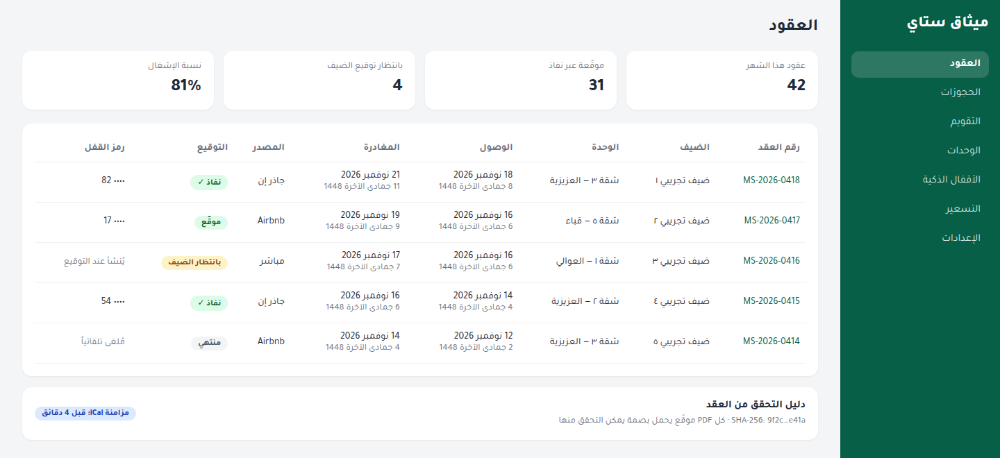
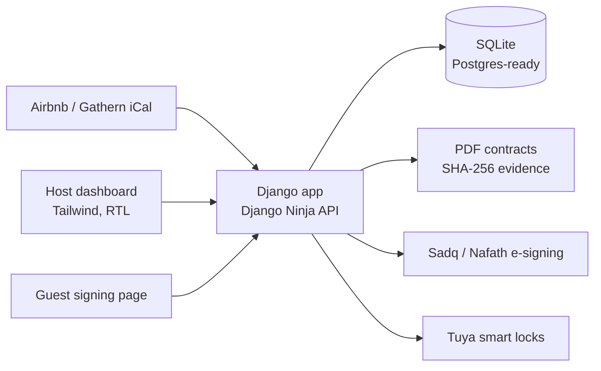

# Mithaq Stay

Short-term rental contract system: Arabic host dashboard, signed PDF contracts, Nafath e-signing and automatic smart-lock passcodes.

**Status:** Live at [mithaqstay.com](https://mithaqstay.com). Built to run my own rental units and used in daily operations.

*UI mockup with demo data; the real dashboard holds private customer data.*

## What it does
- Arabic (RTL) host dashboard for bookings, units and contracts, with Gregorian and Umm al-Qura (Hijri) dates.
- iCal calendar sync with Airbnb and Gathern, so bookings arrive automatically.
- Generates a PDF contract per stay; the guest signs online, optionally with Nafath-verified e-signing through Sadq.
- Creates a Tuya smart-lock passcode for each guest and sends a check-in instructions PDF.

## Architecture

## Engineering highlights
- Each signed PDF carries a SHA-256 hash, so anyone can verify the contract wasn't changed.
- Lock passcodes are created automatically for the stay window and expire after checkout.
- **1,700+ automated tests.**

## Stack
Django · Django Ninja · SQLite (Postgres-ready) · Tailwind CSS · WeasyPrint · Tuya API · Sadq / Nafath

---

Source code is private. Happy to walk through it in an interview: [genjehad@gmail.com](mailto:genjehad@gmail.com) · [LinkedIn](https://linkedin.com/in/jehad-alrehili)
